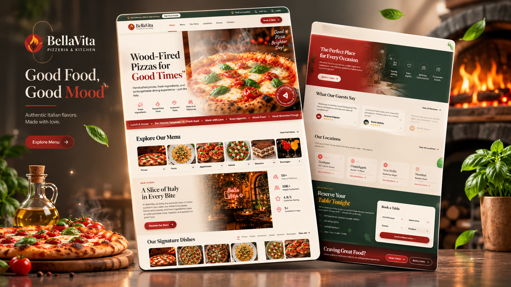

<div align="center">

# 🍕 BellaVita — Pizzeria & Kitchen



### Wood-Fired Pizzas for Good Times

A modern, elegant and fully responsive landing page for an authentic Italian restaurant.
Built with **React**, **Tailwind CSS** and **GSAP**.

<p>
  
  
  
  
</p>

</div>

---

## 📖 Table of Contents

- [About the Project](#-about-the-project)
- [Features](#-features)
- [Page Sections](#-page-sections)
- [Tech Stack](#-tech-stack)
- [Getting Started](#-getting-started)
- [Project Structure](#-project-structure)
- [Animations with GSAP](#-animations-with-gsap)
- [Customization](#-customization)
- [Responsive Design](#-responsive-design)
- [Roadmap](#-roadmap)
- [Contributing](#-contributing)
- [License](#-license)
- [Contact](#-contact)

---

## 🍝 About the Project

**BellaVita** is a premium landing page concept for an Italian pizzeria. It combines a warm color palette (tomato red, deep olive green and cream), elegant serif typography and smooth GSAP animations to create an appetizing experience from the first scroll.

The project showcases:

- Clean, component-based architecture with React
- Utility-first styling with Tailwind CSS
- Scroll-triggered and entrance animations with GSAP
- A pixel-conscious, conversion-focused layout (Order Online / Book a Table)

---

## ✨ Features

- 🎨 **Beautiful UI**: warm, food-focused design with elegant typography
- 🎞️ **Smooth animations**: GSAP + ScrollTrigger reveal effects, parallax and hover micro-interactions
- 📱 **Fully responsive**: mobile, tablet and desktop
- 🍕 **Interactive menu tabs**: filter signature dishes by category
- ⭐ **Testimonials**: guest reviews with ratings
- 📅 **Clear CTAs**: "Order Online" and "Book a Table" across the page
- ⚡ **Fast**: powered by Vite with optimized assets
- 🧩 **Reusable components**: easy to extend and maintain
- ♿ **Accessible**: semantic HTML and proper alt texts

---

## 🧱 Page Sections

| # | Section | Description |
|---|---------|-------------|
| 1 | **Top Bar & Navbar** | Sticky navigation, contact links and *Book a Table* button |
| 2 | **Hero** | Headline, subtitle, CTAs and feature highlights (Fresh Ingredients, Wood-Fired Oven, Authentic Recipes, Dine In/Takeaway) |
| 3 | **Explore Our Menu** | Category cards: Pizzas, Pasta, Appetizers, Salads, Desserts, Beverages |
| 4 | **Our Story** | "A Slice of Italy in Every Bite" with animated stats (50+ dishes, 10K+ customers, 4.8/5 rating, 5+ locations) |
| 5 | **Signature Dishes** | Filterable dish cards with price and add button |
| 6 | **Perfect Place for Every Occasion** | Family Dining, Date Nights, Birthday Celebrations, Corporate Events |
| 7 | **Testimonials** | Google-style guest reviews |
| 8 | **CTA Banner** | Final call to action: Order Online / Book a Table |
| 9 | **Footer** | Quick links, menu links, help, contact info and socials |

---

## 🛠️ Tech Stack

| Technology | Purpose |
|------------|---------|
| [React](https://react.dev/) | UI library |
| [Tailwind CSS](https://tailwindcss.com/) | Utility-first styling |
| [GSAP](https://gsap.com/) | Animations & ScrollTrigger |
| [Vite](https://vitejs.dev/) | Build tool & dev server |
| [React Icons](https://react-icons.github.io/react-icons/) | Icons *(optional)* |

---

## 🚀 Getting Started

### Prerequisites

- **Node.js** `>= 18`
- **npm**, **yarn** or **pnpm**

### Installation

```bash
# 1. Clone the repository
git clone https://github.com/your-username/bellavita.git

# 2. Go to the project folder
cd bellavita

# 3. Install dependencies
npm install

# 4. Start the development server
npm run dev
```

Open **http://localhost:5173** in your browser. 🎉
